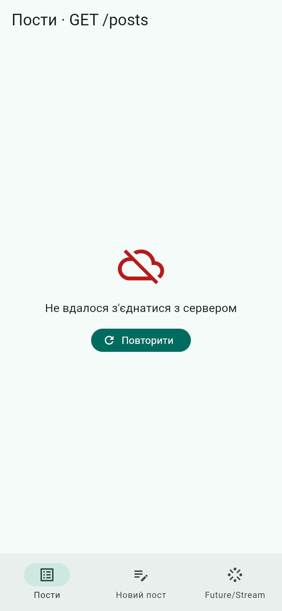
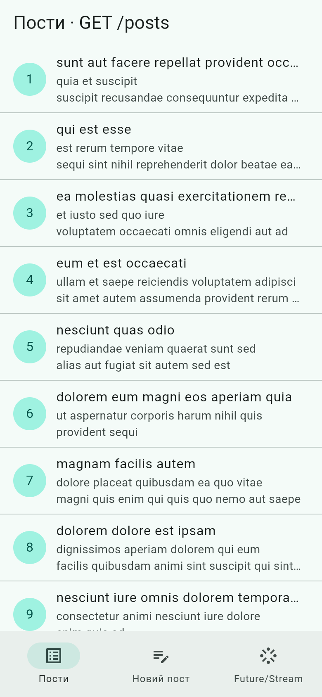
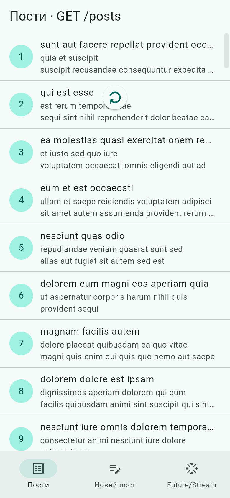
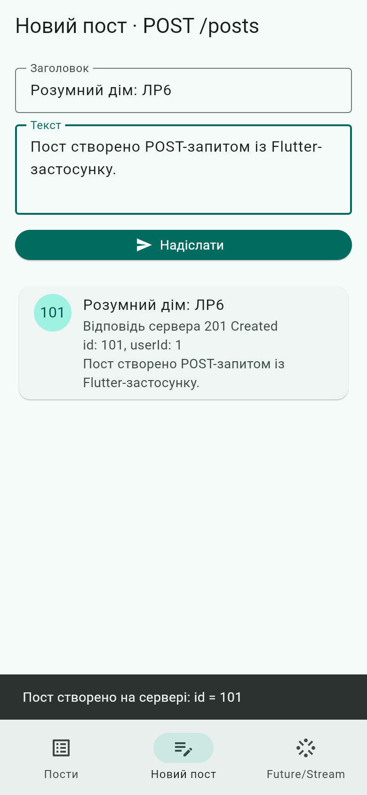
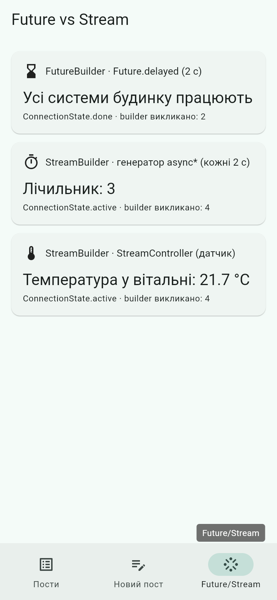

# lab6_async_rest — асинхронність, Stream та REST API у Flutter

Лабораторна робота № 6 з дисципліни «Сучасні технології проєктування».
Flutter-застосунок працює з публічним REST API
[jsonplaceholder.typicode.com](https://jsonplaceholder.typicode.com/posts)
та демонструє `Future`, `async`/`await`, `Stream`, `FutureBuilder` і `StreamBuilder`.

## Реалізований функціонал

| Екран | Що демонструє |
|-------|---------------|
| **Пости** | `GET /posts` через `http.get` з тайм-аутом 10 с і перевіркою `statusCode == 200`; `FutureBuilder` з трьома станами (очікування — `CircularProgressIndicator`, помилка — повідомлення та кнопка **Повторити**, дані — список); pull-to-refresh через `RefreshIndicator` |
| **Новий пост** | `POST /posts` з JSON-тілом і заголовком `Content-Type: application/json`, перевірка `statusCode == 201`, результат і помилки показуються через `SnackBar` |
| **Future/Stream** | одночасно `FutureBuilder` (`Future.delayed`, 2 с) і два `StreamBuilder`: лічильник на генераторі `async*` та датчик температури на `StreamController.broadcast`; під кожним віджетом видно `ConnectionState` і кількість викликів `builder` |

Помилки мережі обробляються в `ApiService._guard()` окремими блоками
`on SocketException`, `on TimeoutException`, `on http.ClientException`, `on FormatException`
та перетворюються на `ApiException` з повідомленням для користувача.

## Структура проєкту

```
lib/
├── main.dart                         MaterialApp, нижня навігація
├── models/post.dart                  Post + factory Post.fromJson()
├── services/
│   ├── api_service.dart              ApiService: getPosts(), createPost(), обробка помилок
│   ├── api_exception.dart            ApiException
│   ├── home_service.dart             Future.delayed + async/await
│   ├── sensor_service.dart           counterStream() (async*), TemperatureSensor (StreamController)
│   └── platform/socket_exception_*   SocketException для мобільних платформ і вебу
├── screens/
│   ├── posts_screen.dart             FutureBuilder, Retry, RefreshIndicator
│   ├── create_post_screen.dart       POST-форма, SnackBar
│   └── future_vs_stream_screen.dart  FutureBuilder і StreamBuilder поруч
└── widgets/error_view.dart           повідомлення про помилку + кнопка «Повторити»
test/                                 тести ApiService (MockClient), потоків і екранів
```

## Скриншоти

| Завантаження | Помилка мережі | Список постів |
|:---:|:---:|:---:|
|  |  |  |
| **Pull-to-refresh** | **POST-запит** | **Future vs Stream** |
|  |  |  |

## Future чи Stream

`Future<T>` — результат **однієї** асинхронної операції: він завершується один раз
значенням або помилкою (HTTP-запит, читання файлу, `Future.delayed`). `FutureBuilder`
перебудовує віджет лише при зміні стану: `waiting` → `done`.

`Stream<T>` — **послідовність** асинхронних подій у часі (показники датчика, лічильник,
повідомлення чату). `StreamBuilder` перебудовує віджет на кожну нову подію, а стан
`active` триває, поки потік не закриється (`done`). Потік можна створити генератором
`async*` (`yield` повертає чергове значення) або `StreamController`, у який події
додаються вручну через `add()`.

На екрані **Future/Stream** це видно за лічильником `builder`: у `FutureBuilder` він
зупиняється на 2, а в обох `StreamBuilder` зростає з кожною подією.

## Запуск

```bash
flutter pub get
flutter analyze
flutter test
flutter run -d chrome
```
